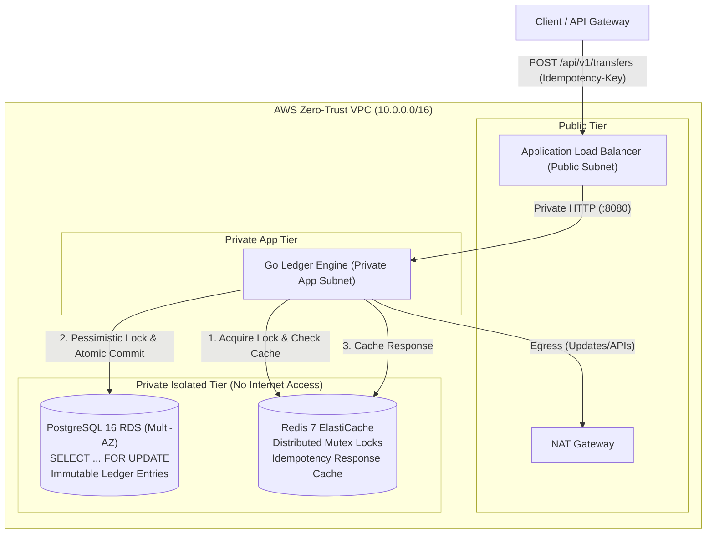

# Idempotent Double-Entry Ledger & Transaction Engine

[](Dockerfile)
[](Dockerfile)
[](LICENSE)

A production-grade, highly-concurrent, immutable double-entry bookkeeping ledger and financial transaction engine written in **Go**, backed by **PostgreSQL 16** (ACID storage), **Redis 7** (distributed locking and idempotency caching), and fully provisioned with zero-trust **Terraform** on AWS VPC.

---

## System Architecture



---

## Core Engineering Highlights

### 1. Immutable Double-Entry Ledger Mechanics
- **Balanced Invariant**: Every financial movement strictly satisfies $\sum \text{Debits} = \sum \text{Credits} > 0$.
- **Non-Negative Balances**: Account balances cannot drop below zero (`chk_account_balance_non_negative CHECK (balance >= 0)`).
- **Append-Only Immutability**: Ledger entries (`entries` table) cannot be updated or deleted. Database-level trigger `prevent_entry_mutation()` raises a fatal Postgres exception on any mutation attempt.
- **Auditing**: Dedicated `/api/v1/ledger/audit` endpoint recalculates global debits vs. credits and detects any discrepancy across all ledger accounts.

### 2. Concurrency Control & Deadlock Prevention
- **Pessimistic Locking**: Executes `SELECT ... FOR UPDATE` on account rows inside atomic transactions before computing new balances.
- **Deterministic Lock Ordering**: When accounts A and B transact, account UUIDs are deterministically sorted in ascending order (`ORDER BY id ASC`). This completely eliminates circular-wait deadlocks during simultaneous bidirectional transfers (e.g. Account A $\to$ Account B racing against Account B $\to$ Account A).
- **Zero Double-Spend**: Tested under heavy concurrency (50 parallel goroutines racing to exhaust account balance) with Go race detector (`-race`) enabled.

### 3. Bulletproof Idempotency Engine
- **Network Retries Handled**: If a client encounters a network timeout and retries a transaction 5+ times with the same `Idempotency-Key`, the transaction executes **exactly once**.
- **Two-Tier Caching**:
  1. **Redis Cache**: Sub-millisecond lookup returns cached status code and serialized response payload with header `X-Idempotent-Replay: true`.
  2. **PostgreSQL Table**: Persistent `idempotency_keys` table guarantees idempotency survival across application or cache reboots.
- **Request Hash Verification**: SHA-256 hash of the request payload is stored. Reusing an existing idempotency key with a mutated payload is immediately rejected with `422 Unprocessable Entity` (`ErrIdempotencyKeyMismatch`).
- **Distributed In-Flight Mutex**: Redis `SETNX` lock prevents simultaneous in-flight requests with identical keys from racing (`409 Conflict`).
- **Single-Transaction Atomicity**: Balance deductions, ledger entry creation, parent transaction record, and idempotency status `COMPLETED` are committed within the **same atomic database transaction**.

### 4. Zero-Trust Cloud Infrastructure (Terraform)
- **3-Tier Network Separation**:
  - `Public Subnet`: ALB and NAT Gateway.
  - `Private App Subnet`: ECS Fargate tasks with no public IP, egress via NAT.
  - `Private Isolated Subnet`: RDS PostgreSQL and Redis ElastiCache with **zero internet routing** and **no public IP**.
- **Least-Privilege Security Groups**: RDS PostgreSQL accepts traffic *strictly* from the ECS application security group on port 5432.
- **Automated Validation**: Full Terraform suite is formatted, linted, and validated via `terraform fmt` and `terraform validate`.

### 5. Multi-Stage Containerization & Security Scanning
- **Minimal Image**: Statically compiled binary (`CGO_ENABLED=0`) running on Alpine 3.21 as non-root user (`UID: 10001`).
- **Tiny Footprint**: Only **22 MB**.
- **Zero Vulnerabilities**: Verified clean by **Aqua Security Trivy** vulnerability scanner (`CRITICAL: 0, HIGH: 0`).

---

## Quick Start (Local Development)

### Prerequisites
- Go 1.24+
- Docker or Podman
- (Optional) Terraform 1.8+

### 1. Start Infrastructure
```bash
make docker-up
```
*Spins up PostgreSQL 16 on port 5432 and Redis 7 on port 6379.*

### 2. Run the Engine
```bash
make run
```
*Automatically applies embedded migrations (`000001_init_schema.up.sql`) and listens on `:8080`.*

### 3. Run Tests (Race Detector & Concurrency)
```bash
make test-integration
```

---

## API Reference & Verification Examples

### 1. Health & Readiness
```bash
curl -i http://localhost:8080/healthz
# HTTP/1.1 200 OK
# {"status":"UP"}

curl -i http://localhost:8080/readyz
# HTTP/1.1 200 OK
# {"database":"connected","redis":"connected","status":"READY"}
```

---

### 2. Create Accounts
```bash
# Create Account A (Alice) with 10,000 cents ($100.00 USD)
curl -s -X POST http://localhost:8080/api/v1/accounts \
  -H "Content-Type: application/json" \
  -d '{"name": "Alice Main Account", "currency": "USD", "initial_balance": 10000}' | jq
```
```json
{
  "id": "1d8bfdfa-394f-4d92-8ec2-13203403a3d1",
  "name": "Alice Main Account",
  "currency": "USD",
  "balance": 10000,
  "status": "ACTIVE",
  "created_at": "2026-10-12T17:40:00Z",
  "updated_at": "2026-10-12T17:40:00Z"
}
```

```bash
# Create Account B (Bob) with 0 cents ($0.00 USD)
curl -s -X POST http://localhost:8080/api/v1/accounts \
  -H "Content-Type: application/json" \
  -d '{"name": "Bob Savings", "currency": "USD", "initial_balance": 0}' | jq
```

---

### 3. Execute Idempotent Fund Transfer
```bash
# Transfer 2,500 cents ($25.00) from Alice to Bob
curl -i -X POST http://localhost:8080/api/v1/transfers \
  -H "Content-Type: application/json" \
  -H "Idempotency-Key: txn_transfer_uuid_001" \
  -d '{
    "source_account_id": "1d8bfdfa-394f-4d92-8ec2-13203403a3d1",
    "destination_account_id": "8a329ef1-4ef3-469b-8664-7b931dc1ef10",
    "amount": 2500,
    "reference": "PAY-INV-1092",
    "description": "Invoice payment"
  }'
```
**Response (HTTP 201 Created):**
```json
{
  "id": "7ac2e185-3b91-49e2-9b24-bfef6df1d31a",
  "reference": "PAY-INV-1092",
  "description": "Invoice payment",
  "status": "POSTED",
  "entries": [
    {
      "id": "038cfbca-3269-4560-8488-ea9a738dfc6f",
      "transaction_id": "7ac2e185-3b91-49e2-9b24-bfef6df1d31a",
      "account_id": "1d8bfdfa-394f-4d92-8ec2-13203403a3d1",
      "amount": 2500,
      "direction": "DEBIT",
      "balance_after": 7500,
      "created_at": "2026-10-12T17:40:05Z"
    },
    {
      "id": "99ea7034-45da-48eb-bfb7-3c58c2ec173b",
      "transaction_id": "7ac2e185-3b91-49e2-9b24-bfef6df1d31a",
      "account_id": "8a329ef1-4ef3-469b-8664-7b931dc1ef10",
      "amount": 2500,
      "direction": "CREDIT",
      "balance_after": 2500,
      "created_at": "2026-10-12T17:40:05Z"
    }
  ],
  "created_at": "2026-10-12T17:40:05Z",
  "posted_at": "2026-10-12T17:40:05Z"
}
```

---

### 4. Retry the Same Request (Idempotency Replay)
Executing the exact same `curl` command with `Idempotency-Key: txn_transfer_uuid_001`:
```
HTTP/1.1 201 Created
X-Idempotent-Replay: true
Content-Type: application/json
```
- Alice's balance remains at **7,500 cents** (not deducted twice).
- Returned transaction ID and entries match the original.

---

### 5. Multi-Split Transaction (Custom Double-Entry Posting)
```bash
curl -s -X POST http://localhost:8080/api/v1/transactions \
  -H "Content-Type: application/json" \
  -H "Idempotency-Key: txn_split_002" \
  -d '{
    "reference": "SPLIT-PAYROLL-01",
    "description": "Split transfer test",
    "entries": [
      { "account_id": "1d8bfdfa-394f-4d92-8ec2-13203403a3d1", "amount": 2000, "direction": "DEBIT" },
      { "account_id": "8a329ef1-4ef3-469b-8664-7b931dc1ef10", "amount": 1500, "direction": "CREDIT" },
      { "account_id": "cc0788db-b062-4211-a8bb-d0b5711b7dfb", "amount": 500, "direction": "CREDIT" }
    ]
  }' | jq
```

---

### 6. Audit Global Ledger Consistency
```bash
curl -s http://localhost:8080/api/v1/ledger/audit | jq
```
```json
{
  "total_debits": 4500,
  "total_credits": 4500,
  "is_ledger_balanced": true
}
```

---

## 🛠️ Project Structure

```
.
├── .github/
│   └── workflows/
│       └── ci.yml                 # CI/CD: Go unit & race tests, Terraform validate, Trivy scan
├── cmd/
│   └── server/
│       └── main.go                # Server entrypoint with graceful shutdown & embedded migrations
├── internal/
│   ├── api/
│   │   ├── dto/                   # HTTP Request and Response DTOs
│   │   └── rest/                  # Chi router, handlers, and security middleware
│   ├── config/                    # Environment configuration loader
│   ├── domain/                    # Pure domain models, entities, and business invariants
│   ├── repository/
│   │   ├── postgres/              # PostgreSQL pgx/v5 repo, row locking, and SQL migrations
│   │   └── redis/                 # Redis client, distributed lock service, response caching
│   └── service/                   # Ledger and Idempotency application services
├── terraform/
│   ├── environments/
│   │   └── prod/                  # Production AWS deployment environment
│   └── modules/
│       ├── compute/               # AWS ECS Fargate & ALB
│       ├── database/              # AWS RDS PostgreSQL 16 (Multi-AZ, Isolated Subnet)
│       ├── redis/                 # AWS ElastiCache Redis Replication Group
│       ├── security/              # Security groups with least privilege
│       └── vpc/                   # 3-tier VPC with public, private app, and isolated DB subnets
├── test/
│   └── integration/
│       └── concurrency_test.go    # High-concurrency race condition and deadlock tests
├── docker-compose.yml             # Local multi-container development environment
├── Dockerfile                     # Multi-stage, non-root minimal Alpine image (22MB)
├── Makefile                       # Developer build, test, scan, and deploy targets
└── README.md                      # Architecture and documentation
```

---

## Security & Trivy Scanning

The production Docker container is built with a multi-stage `Dockerfile`:
- **Builder Stage**: `golang:alpine` compiles a statically-linked minimal binary (`-trimpath -ldflags="-w -s"`).
- **Runtime Stage**: `alpine:3.21` running as non-root user (`UID 10001:10001`).
- Scanned with `aquasecurity/trivy`:
```bash
make trivy-scan
```
**Results:** `0 CRITICAL`, `0 HIGH`, `0 MEDIUM`, `0 LOW`.

---

## License
MIT License. Created for high-integrity financial ledger and transaction processing.
